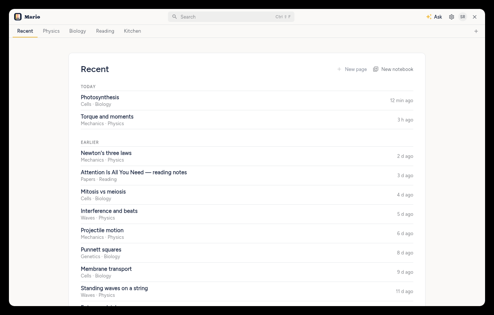
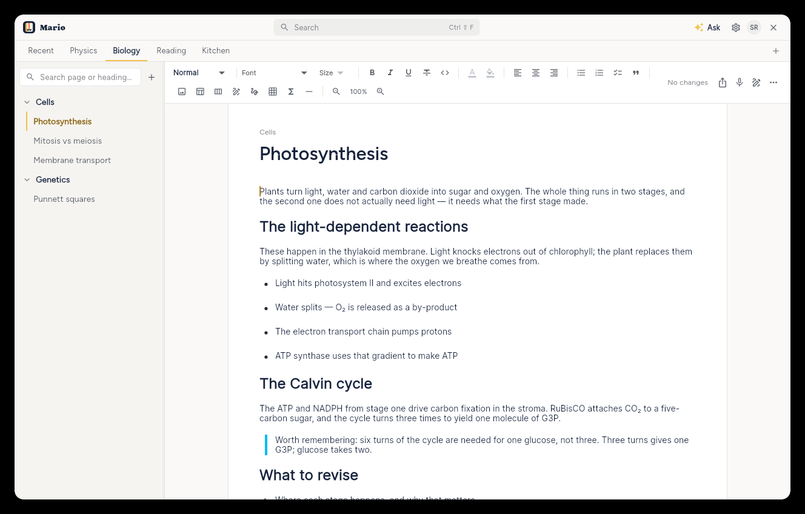
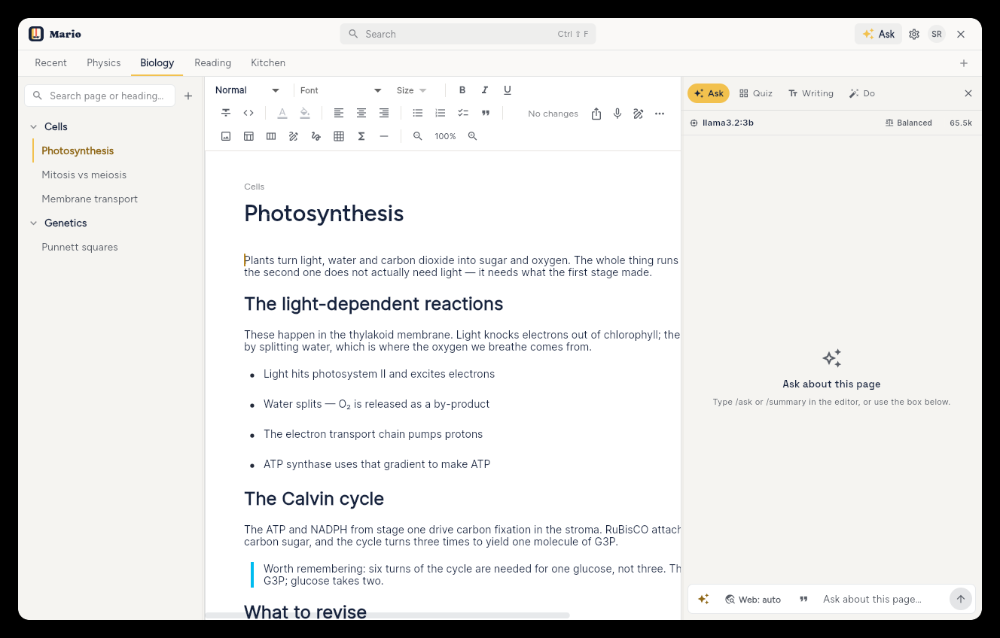
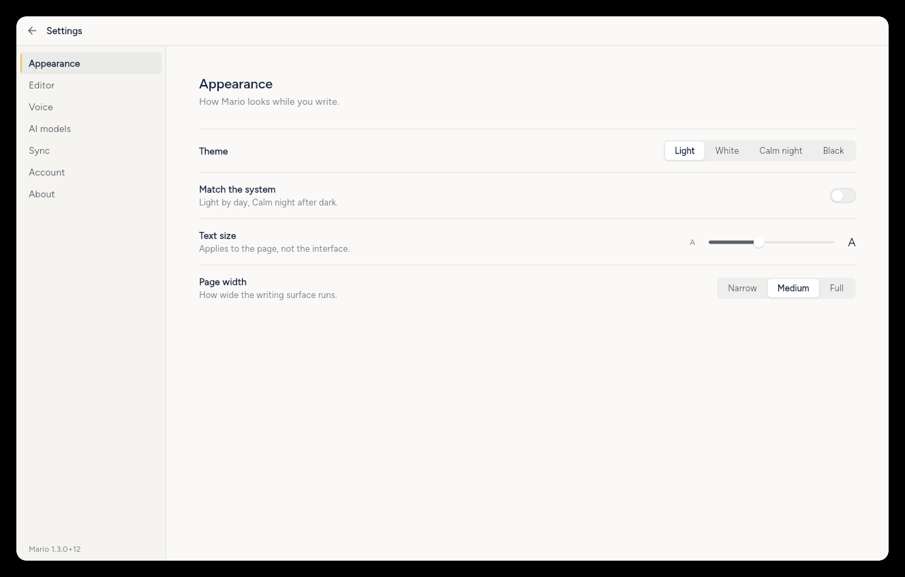
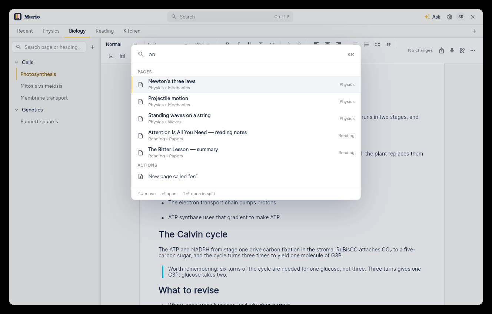
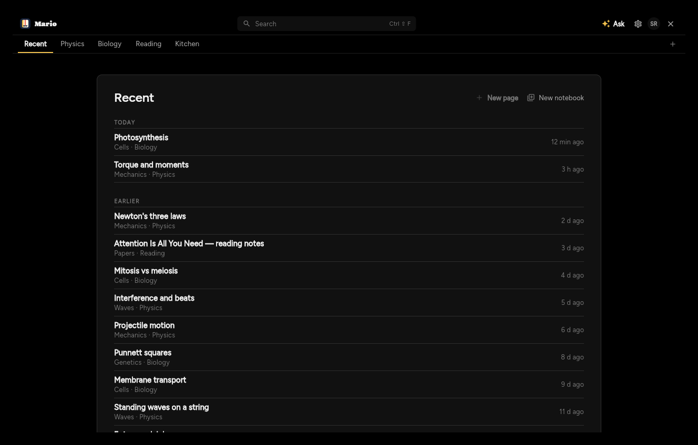
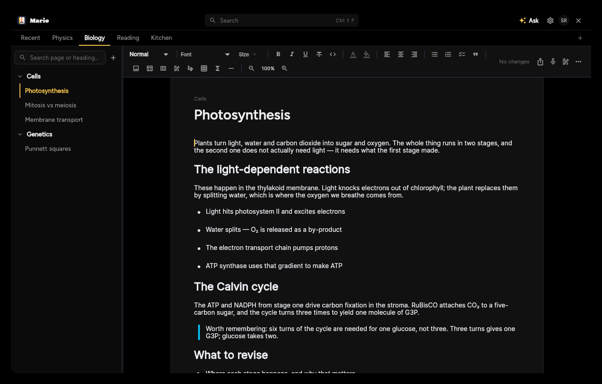
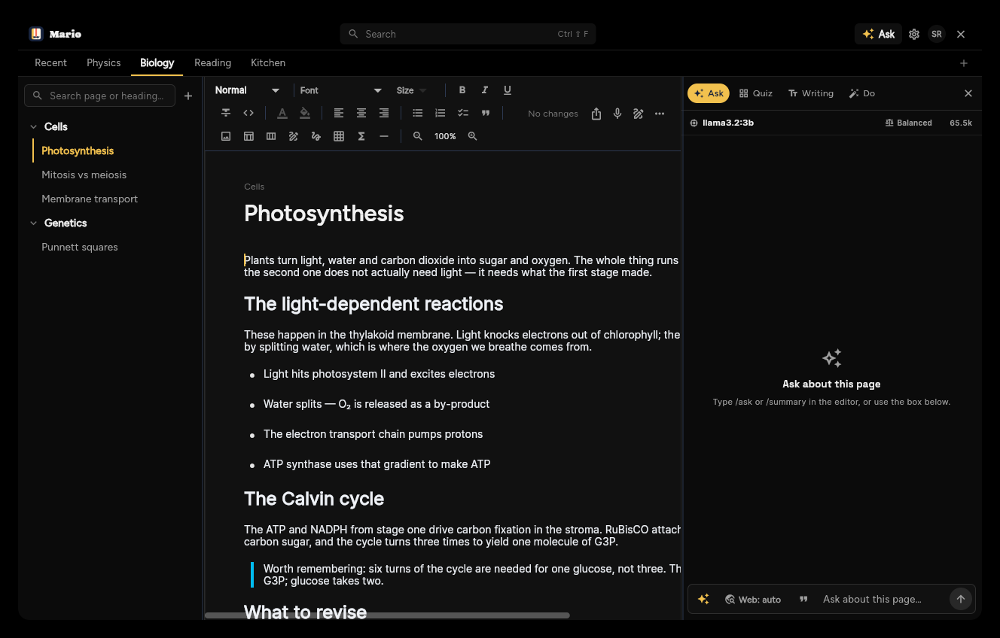
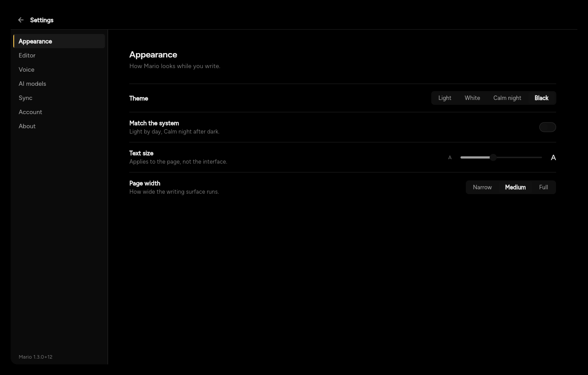
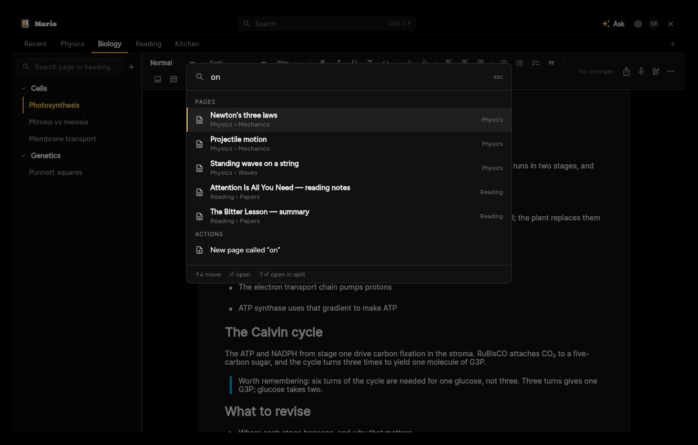

# Mario

**Your notes, your world.**

Mario is a block-based notes app built with Flutter. It pairs a rich, Notion-style
editor with first-class support for math, code, drawing, spreadsheets and voice —
then syncs your work to the cloud and exports it to PDF or Markdown. It runs as a
native Linux or Windows desktop app and in the browser.

**Current release: 1.3.4** — see [What's new](#whats-new-in-134).

---

## Screenshots

|  |  |
|---|---|
|  <br> **Recent** — where you land: your pages newest-first, notebooks as tabs above |  <br> **Editor** — the page, its breadcrumb and save state |
|  <br> **AI panel** — Ask, Quiz, Writing and Do behind one composer, naming the model and its context budget |  <br> **Settings** — one pane at a time, not one long scroll |



*Search — one palette over every page, driven from the keyboard.*

### On the Black ground

|  |  |
|---|---|
|  |  |
|  |  |



*All four themes share one layout and one type system — only the ground changes.*

> **The notebooks in these shots are invented.** They come from a demo build
> (`--dart-define=MARIO_DEMO=true`) running against the fixtures in
> [`lib/core/demo/demo_data.dart`](lib/core/demo/demo_data.dart), so the app can
> be photographed without putting anyone's real notes in a public repository.
> [docs/screenshots/README.md](docs/screenshots/README.md) says how to regenerate them.

---

## What's new in 1.3.4

**Windows installer and Mario icon.** Install Mario with the Windows x64 setup
EXE from [GitHub Releases](https://github.com/tdulshan3/mario/releases/latest),
or extract the portable ZIP and run `mario.exe`. The installer adds a Start menu
shortcut, offers a desktop shortcut, and supports uninstalling through Windows
Settings. Both packages include the Visual C++ runtime and desktop Google sign-in
configuration. The app and installer use Mario's notebook logo.

Windows builds also fix compatibility with newer CMake and Flutter message
codecs in the embedded browser plugin.

**Pages read like a Markdown preview.** The editor now sets text the way VS
Code's preview does: 14px on a 22px line, headings on the browser scale with a
band of air above and below, a rule under a level-1 heading, a 2px horizontal
rule, and `:tada:`-style shortcodes that turn into emoji as you type. The fix
underneath it is spacing, not type — every block used to carry 8px of editor
padding top and bottom, so a page written one thought per line, or any list,
had 16px between each line and the next. Blocks now carry no padding of their
own; the line box does the work, and a list, a quote or a heading takes only
the space a preview gives it. AI answers in the side panel follow the same
stylesheet, with list items a line apart instead of a line and a half.

**Do is an agent now.** Instead of a rulebook, the model is handed a
description of what Mario has and a set of skills — how to edit the open page,
how to make pages, sections and notebooks, how to read and search, how Mario
renders Markdown — and it works in turns: it can read another page, list the
notebook, search your notes or the web, and decide the next step from what
came back. It can write into any page, open one, ask you a question (reply in
the box to carry on) and suggest follow-ups you can tap. Changes are no longer
paused for approval by default; the step list shows each one as it happens and
**Undo all** still puts the page back. When Mario refuses an action (a rewrite
with no text, an id that is not on the page) or a step fails on the page, the
reason goes back to the model and it tries another way, twice, before giving
up — and "nothing to change" is an answer rather than an error. **Preview before writing** turns the
old review step back on. Pages, sections and notebooks are never deleted by
the agent. Drop your own `*.md` skills into `~/.local/share/com.marionote.app.mario/skills/` and
they are added to what the model is told.

**Notebooks, sections and pages work offline.** Creating, renaming and
deleting no longer wait for Firestore or Drive. A change lands on this device
first — the sidebar shows it, the editor opens a brand-new page at once — and
goes into an outbox that sends it to the server in order, straight away when
the network is there and on a backoff when it is not, surviving a restart in
between. The tree the server last sent is kept on disk, so the app opens to
your notebooks on a train instead of an error. A page created offline gets
its Drive file when Drive is back, and a save that failed to upload is pushed
then too. The editor's status line counts changes still waiting to sync.

**Drag to reorder and move.** Sections and pages in the sidebar can be
picked up with a short press and dropped: a section before or after another,
a page before or after another page — in its own section or a different one —
or onto a section's header to move it there. An accent line shows where the
drop will land. The new order is written through the sync service, so it
works offline like everything else.

**Quizzes generate on thinking models, and essays have room.** A hybrid
model at the default depth planned a batch of multiple-choice questions
straight through its output budget and wrote nothing, so quizzes came back
with no MCQs. Any structured request that thinks its budget away is now
asked once more without thinking, so a quiz comes back instead of an error
while you keep the depth you chose. The item validator also reads the shapes small models actually
write — a letter or the option's text for the answer, labelled options,
three to six choices — and the step line says why a batch was unusable. The
essay answer box starts at eight lines, grows as you write, and opens in a
window-sized editor.

**Markdown imports keep more.** Pasted or generated Markdown now keeps its
`$$…$$` and ```` ```math ```` formulas (as formula blocks) and its
`> [!NOTE]` / `[!TIP]` / `[!IMPORTANT]` callouts (as titled quotes), where the
stock decoder dropped both.

**Do keeps its history.** Finished runs are saved beside Ask's, per notebook,
and listed under the launcher: what was asked, what changed, **Run again**.
Any saved chat, Ask or Do, can be deleted, and the deletion sticks across
devices — the notebook's AI file now merges by id and remembers what was
removed, where it used to adopt whichever copy was bigger.

---

## What's new in 1.3.3

**User-controlled model context.** Each AI model now has a context-window field
under **Settings → AI models → Edit**. Leave it on Auto, choose a common preset
from 8k through 1m, or enter an exact value such as `131072` or `128k`. Mario
uses the saved value for note budgeting and sends it as `num_ctx` to local
servers; hosted providers use it only to limit what Mario sends. Values are
validated from 1k to 4m to prevent accidental local memory exhaustion.

**More reliable Do-tab rewrites.** Rewrite plans no longer disappear when a
non-strict model returns their finished text under common replacement field
names. Submitted instructions clear from the composer after hand-off, while a
hand-off error leaves the draft available to retry.

---

## What's new in 1.3.2

**Math delimiters render correctly.** Math blocks now accept formulas pasted or
generated as `$...$`, `$$...$$`, `\(...\)`, `\[...\]`, or fenced LaTeX. Mario
removes the outer Markdown wrapper before entering the renderer's existing math
mode, preventing the “Can't use function '$' in math mode” error. Previously
saved affected blocks are repaired when read, without recreating the formula.

---

## What's new in 1.3.1

**AI artifacts and review-before-write.** Ask is now a general assistant rather
than being artificially limited to facts already present in a note. A full HTML
document pasted into a page is retained as exact model context — including its
CSS and JavaScript — so a follow-up can revise the real artifact instead of a
flattened text approximation.

- **Claude-style HTML artifacts** — Ask answers containing a fenced HTML
  document get a **Preview HTML** action. The Do tab renders the result live in
  a sandboxed Chromium preview, with an explicit **Apply to page** step.
- **HTML from Do** — the page agent can create or revise a complete,
  self-contained HTML artifact. It receives the page's persisted HTML source,
  not only the editor's lossy block conversion, and gets a larger output budget
  so complete documents are not cut off halfway through.
- **Do previews before writing** — every validated page-edit plan now pauses on
  a readable list of proposed changes. Nothing touches the page until **Apply
  changes** is pressed; **Discard** leaves it untouched, and **Undo all** still
  restores the full page, title, and prior HTML artifact.
- **Safety stays at the execution boundary** — generated HTML can use inline
  CSS and JavaScript, but its in-app preview has no same-origin, top-navigation,
  pop-up, download, or fetch/XHR privilege. Web-search injection checks
  and validated editor actions remain in place.

## What's new in 1.3.0

**The Simple remodel.** The chrome got out of the way. The top bar went from 68px
of glass and pill buttons to a 43px flat strip separated by a single rule; the
notebook rail — a 60px column of coloured avatars — became a 35px strip of plain
text tabs under it, led by **Recent**. Turning that column on its side is what
lets the sidebar be one flat tree of sections and pages instead of a picker card
stacked over a tree.

- **Search is a command palette** — `↑↓`, `↵`, `esc`, with a breadcrumb under each
  hit. Titles only for now, and it says so rather than implying otherwise.
- **Settings is two panes** — categories on the left, one pane at a time on the
  right, so the theme picker is findable. On a narrow window the rail collapses
  to a list rather than becoming unreachable.
- **Ask on the page** — `/ask` opens at the caret instead of in the side panel,
  and shares its run with the Ask tab.
- **Inserted answers keep their code** — fenced code blocks used to be dropped
  on the way into a note, so an answer explaining a function wrote the prose and
  threw the function away. They now land as real, syntax-highlighted code blocks
  with the language already selected.
- **Page width works** — Narrow / Medium / Full were stored but ignored by an
  editor that hard-coded a 780px card. They are now 620 / 720 / 880.
- **Gemini** joins Ollama, OpenAI-compatible servers, OpenAI and Claude.
- **Local models get room to think** — the assumed context window for a local
  backend went from 8k to 64k, and is now sent as `num_ctx` with every call, so
  a long page stops being trimmed to fit a window the hardware never imposed.
- **A demo mode**, for screenshots and demos. `--dart-define=MARIO_DEMO=true`
  runs the real build against fixture notebooks and never reaches the network,
  so the app can be shown without an account and without anyone's real notes.

---

## Features

### Rich block editor
Built on [`appflowy_editor`](https://pub.dev/packages/appflowy_editor) with a set of
custom blocks:

- **Code** — IDE-style block with syntax highlighting (`re_highlight`, the same
  highlight.js port AppFlowy uses), copy/paste/cut support and multi-language themes.
- **Math** — inline and block LaTeX rendering via `flutter_math_fork` (KaTeX), plus
  live expression evaluation (`math_expressions`).
- **Drawing** — freehand ink canvas (`perfect_freehand`) with a drawing toolbar,
  usable both as a standalone block and as an overlay layer on any page.
- **Spreadsheet** — a grid with a formula evaluator and `.xlsx` import (`excel`).
- **Image** — drag-and-drop / paste images, embedded directly into exports.
- **Table** and **Audio** blocks.

### Capture & organize
- **Notebooks → sections → pages** — notebooks are text tabs along a strip under
  the top bar, led by **Recent** (the home screen, so there is always a way back
  to it from inside a page). That frees the sidebar to be one flat tree of the
  live notebook's sections and their pages, with no picker card above it.
- **Voice dictation** — speech-to-text (`speech_to_text`) plus audio recording and
  playback (`record`, `just_audio`).
- **OCR** — extract text from images.
- **Search** — a command palette over your pages, driven from the keyboard
  (`↑↓` moves, `↵` opens, `esc` closes). It matches titles and shows each hit's
  breadcrumb; full content search waits on the SQLite FTS index.
- **AI assist** — see the section below.

### AI study tools
Bring your own model. Mario talks to a local one through **Ollama**, to any
**OpenAI-compatible** server on your network (llama.cpp's `llama-server`,
LM Studio, vLLM, Jan), to **OpenAI**, to **Claude**, or to **Gemini** — configured
in *Settings → AI models*, with a Test button that says what is actually wrong
when a connection fails. Keys live in the OS secure storage; nothing works, and
nothing is sent anywhere, until you set a backend up.

- **`/summary`** — summarises the note above the cursor.
- **`/ask`** — opens a composer *at the caret*, on the page, rather than sending
  you to the side panel. It reads the page, optionally searches the web (Serper),
  and puts the answer inline above the composer, ready to insert into the note
  with its sources. It is the same run as the Ask tab: start it inline and open
  the panel to watch it finish, or the other way round.
- **`/quiz`** — a right-hand panel that builds a paper from the current page or
  a whole section: multiple choice plus essay questions, generated in batches
  and validated as they arrive.
- **Marking** — multiple choice is marked in plain Dart, instantly and offline.
  Essays are marked against a rubric, shown with the points they hit and missed,
  labelled a draft, and editable — a small model's opinion of an essay is an
  opinion, not a grade.
- **Writing check** — on-demand spelling and grammar suggestions, accepted or
  ignored one at a time, each its own undo step.
- **Do** — preview and apply work on the page: pull out the to-dos, turn a bullet
  list into a table, translate it, tighten the writing, or create an interactive
  HTML artifact. The proposed actions are shown before anything is written,
  then applied as one undoable run.

The panel keeps all four — Ask, Quiz, Writing and Do — behind one composer, and
says what the model is doing while it works: the running step in its own words
("searching the web", "reading page 3 of 12"), and how long it has been at it.
An idle panel stays quiet rather than claiming a status it does not have.

Summaries, answers, quizzes and marks are saved to the same private Google Drive
folder as your notes, so they follow you between machines and work offline. A
saved summary doubles as cached context, which is what makes a second question
about a long section fast.

### Sync & storage
- **Cloud sync** via Firebase/Firestore on web, and via `firedart` on Linux (where
  the official FlutterFire SDK has no native support).
- **Google Drive** integration for page content.
- **Local persistence** with `drift` (SQLite), `shared_preferences` and
  `flutter_secure_storage`.
- **Google OAuth** sign-in — a desktop OAuth client on Linux, Firebase Auth on web.

### Export
- **PDF** — paginated, with embedded images and bundled Noto fonts for broad Unicode
  coverage (non-Latin scripts and math symbols render correctly).
- **Markdown**.

### Desktop experience
- Native window management and a system tray (`window_manager`, `tray_manager`).
- Embedded HTML preview via Chromium/CEF (`webview_cef`), including sandboxed
  live previews for AI-created artifacts.
- **Four themes** — Light (cream), White (for bright rooms and printing),
  Calm night (the mark's navy) and Black (pure `#000`, for OLED) — plus a
  system mode that pairs Light by day with Calm night after dark.

---

## Platforms

| Platform | Status |
|----------|--------|
| Linux (desktop) | Primary target — native build via `firedart` + CEF |
| Web | Supported — Firebase path |
| macOS / Windows | Scaffolded (fall back to FlutterFire) |
| iOS / Android | Project scaffolding present |

---

## Getting started

### Prerequisites
- [Flutter](https://docs.flutter.dev/get-started/install) SDK (Dart `>=3.3.0 <4.0.0`)
- For Linux desktop builds: `clang`, `cmake`, `ninja`, `pkg-config` and the GTK3
  dev headers.

> **Note:** the first Linux build downloads CEF (Chromium) for the embedded HTML
> preview. The archive is ~150 MB but unpacks to roughly **3 GB** under
> `third_party/webview_cef/third/cef/`, which is gitignored — it is a build
> artifact, fetched by `download.cmake`, not source.

### Configuration
Mario needs a Google OAuth **desktop client id + secret** for Google sign-in / Drive.
Supply them either as environment variables:

```bash
export MARIO_DESKTOP_CLIENT_ID=...
export MARIO_DESKTOP_CLIENT_SECRET=...
```

…or via a `.env` in the repo root (the dev workflow — see
[`lib/platform/linux/secrets_loader.dart`](lib/platform/linux/secrets_loader.dart)
for the expected format). The Anthropic API key for AI features is entered in-app
under **Settings** and kept in secure storage.

### Run in development

```bash
flutter pub get
flutter run -d linux    # or: flutter run -d chrome
```

When running on Linux, pass the OAuth credentials through:

```bash
flutter run -d linux \
  --dart-define=MARIO_DESKTOP_CLIENT_ID="$MARIO_DESKTOP_CLIENT_ID" \
  --dart-define=MARIO_DESKTOP_CLIENT_SECRET="$MARIO_DESKTOP_CLIENT_SECRET"
```

---

## Install on Linux

A one-shot installer builds a release bundle (with the OAuth secrets baked in via
`--dart-define`) and installs it into `/opt/mario`:

```bash
# from a clone:
bash scripts/install.sh

# or one-liner:
curl -fsSL https://raw.githubusercontent.com/tdulshan3/mario/master/scripts/install.sh | bash
```

Then launch **Mario** from your application menu or run `mario` in a terminal.

**Uninstall:**
```bash
sudo rm -rf /opt/mario /usr/local/bin/mario \
  /usr/share/applications/mario.desktop \
  /usr/share/icons/hicolor/256x256/apps/mario.png
```

### Arch Linux
Packaging scripts and a `PKGBUILD` live under [`packaging/arch/`](packaging/arch/).

## Build on Windows

Flutter builds Windows apps only on Windows (there is no cross-compiling from
Linux), so this happens on a Windows machine or VM:

1. Install [Flutter](https://docs.flutter.dev/get-started/install/windows)
   (the same stable channel as this repo), Git, and **Visual Studio 2022**
   with the **Desktop development with C++** workload (CMake and the Windows
   SDK come with it). `flutter doctor` must show the Visual Studio line green.
2. Clone the repo, then in PowerShell from its root:

   ```powershell
   flutter pub get
   flutter build windows --release `
     --dart-define=MARIO_DESKTOP_CLIENT_ID=<your desktop client id> `
     --dart-define=MARIO_DESKTOP_CLIENT_SECRET=<your desktop client secret>
   ```

   The first build downloads the CEF binaries for the HTML preview (a few
   hundred megabytes) and the Firebase C++ SDK; both are cached afterwards.
3. The app is the whole folder `build\windows\x64\runner\Release\` —
   `mario.exe` plus the DLLs and `data\` beside it. Copy that folder as one
   unit; the exe does not run alone.

Windows shares the Linux sign-in and sync stack (a loopback OAuth flow and
firedart), so the same Desktop OAuth client works. If you would rather not
bake the credentials in, a `.env` file next to `mario.exe` with
`desktopclientid=` and `desktopclientsecret=` lines is read at start-up.
OCR needs `tesseract` on the PATH; without it the feature is simply off.

To build a distributable ZIP using credentials in the ignored root `.env`
(`desktopclientid=` and `desktopclientsecret=`), run:

```powershell
powershell -NoProfile -ExecutionPolicy Bypass -File scripts/build-windows.ps1
```

Pass `-Flutter <path-to-flutter.bat>` if Flutter is not on your PATH. The script
embeds the credentials, packages the entire Release folder into
`build/mario-<version>-windows-x64.zip`, and writes a SHA-256 checksum beside it.
It includes the x64 Visual C++ runtime from the installed Visual Studio tools;
use `-CrtDirectory <directory>` to supply those redistributable DLLs explicitly.

To also create an installer, install Inno Setup and pass
`-InstallerCompiler <path-to-ISCC.exe>`. The installer and its checksum are written
to `build/mario-<version>-windows-x64-setup.exe` and the adjacent `.sha256` file.
To regenerate the multi-size Windows icon from `assets/logo/mario_mark.png`, run
`powershell -NoProfile -ExecutionPolicy Bypass -File scripts/build-windows-icon.ps1`.

---

## Project layout

```
lib/
├── main.dart              # entrypoint — platform-aware init (Firebase / firedart)
├── app.dart               # root MaterialApp.router, theming, auth-aware routing
├── core/
│   ├── models/            # Notebook, Section, NotePage, Collaborator
│   ├── demo/              # fixture data behind --dart-define=MARIO_DEMO
│   └── services/          # auth, drive, firestore, sync, OCR, voice, caching
├── features/
│   ├── editor/            # editor screen + custom blocks (code, math, drawing, …)
│   ├── drawing/           # freehand canvas + strokes
│   ├── math/              # tokenizer / evaluator / shortcuts
│   ├── spreadsheet/       # sheet data, formula evaluator, xlsx parser
│   ├── export/            # PDF + Markdown exporters
│   ├── voice/             # dictation
│   ├── shell/             # nav tree, notebook tabs, toolbar, shortcuts
│   ├── auth/ · search/ · settings/ · sharing/
└── platform/
    ├── linux/             # firedart client, secrets loader, window config
    └── web/               # Firebase/Firestore + web auth/OCR
```

**Stack:** Flutter · Riverpod + GetIt + go_router · Firebase / Firestore / firedart ·
Google APIs · AppFlowy Editor · drift.

---

## Building a release

```bash
flutter build linux --release \
  --dart-define=MARIO_DESKTOP_CLIENT_ID="$MARIO_DESKTOP_CLIENT_ID" \
  --dart-define=MARIO_DESKTOP_CLIENT_SECRET="$MARIO_DESKTOP_CLIENT_SECRET"
```

The bundle is written to `build/linux/x64/release/bundle`.
